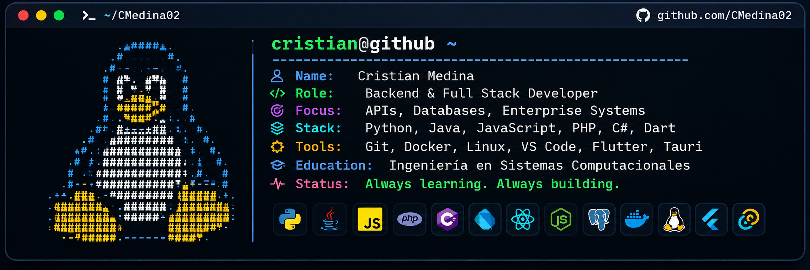

# Hola, soy Cristian Medina

### Software Developer | Backend & Full Stack

Soy estudiante de **Ingeniería en Sistemas Computacionales**, enfocado en el desarrollo de software, especialmente en aplicaciones Backend, Full Stack y sistemas empresariales.

Me interesa construir soluciones prácticas, diseñar APIs, trabajar con bases de datos y desarrollar aplicaciones mantenibles aplicando buenas prácticas de programación.

---

## Tecnologías y herramientas

**Lenguajes**

Python · Java · JavaScript · PHP · C# · SQL · Dart

**Backend**

Flask · FastAPI · Node.js · Express · Spring Boot · APIs REST

**Frontend**

React · TypeScript · HTML5 · CSS3 · JavaScript

**Bases de datos**

PostgreSQL · SQLite

**Herramientas y entornos**

Git · GitHub · Docker · Linux · VS Code · Flutter · Tauri

---

## Proyectos destacados

### 🪐 [Mapte — Mars Exploration Platform](https://github.com/CMedina02/Mapte)

Plataforma web interactiva desarrollada en equipo para **NASA Space Apps Challenge 2026**, orientada a la exploración científica de Marte.

Incluye visualización 2D/3D, planificación de rutas con A*, simulaciones, APIs REST, procesamiento de información geoespacial y persistencia de misiones.

**Tecnologías:** React · TypeScript · Python · FastAPI · SQLite · Three.js

### 📋 [KanbanProject — Agile Project Management](https://github.com/CMedina02/KanbanProject)

Aplicación Full Stack para la gestión de proyectos mediante tableros Kanban.

Permite administrar tareas, organizar columnas, registrar actividades, utilizar cronómetros y consultar métricas de seguimiento.

**Tecnologías:** Node.js · Express · JavaScript · SQLite

### 🍕 [PizzeriaPaco2.0 — Point of Sale](https://github.com/CMedina02/PizzeriaPaco2.0-POS)

Sistema de punto de venta de escritorio orientado a operaciones comerciales.

Incluye gestión de pedidos, catálogo de productos, control de insumos, administración de usuarios y operaciones de caja.

**Tecnologías:** React · Tauri · Rust · SQLite

### 🏭 [Produccion-Merma — Material Calculator](https://github.com/CMedina02/Produccion-Merma)

Aplicación web para consultar registros de producción y calcular materiales necesarios considerando porcentajes de merma.

Cuenta con autenticación, roles, administración de registros, persistencia SQLite y pruebas automatizadas.

**Tecnologías:** Python · Flask · SQLite · Bootstrap

---

## Otros proyectos

- **[Compiladosr](https://github.com/CMedina02/Compiladosr):** Analizador y mini compilador en Python con optimización y generación de código ensamblador 8086.
- **[login_bear_animation](https://github.com/CMedina02/login_bear_animation):** Interfaz de inicio de sesión desarrollada con Flutter y animaciones Rive.

---

## Actualmente

- Fortaleciendo mis conocimientos en arquitectura Backend y Full Stack.
- Desarrollando aplicaciones con Flutter, Python y Java.
- Aprendiendo sobre diseño de APIs y bases de datos.
- Trabajando en proyectos de software modular y empresarial.

---

## Contacto

**GitHub:** [github.com/CMedina02](https://github.com/CMedina02)

*Always learning. Always building.*
